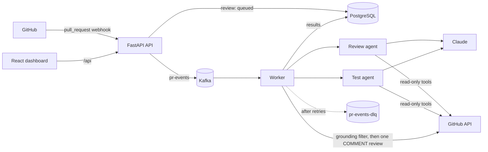

# PR Copilot

A GitHub App that reviews pull requests with AI agents. When a PR is opened or updated, two
Claude agents run in parallel. One looks for bugs, security issues and risky patterns; the
other proposes concrete test cases. PR Copilot then posts a single review with inline
comments, but only on lines the PR actually changed. A dashboard shows every review, its
comments, and its token usage and cost.

> **Screenshot placeholder:** add `docs/screenshot.png` (the dashboard after a real review)
> and reference it here.

## How it works



1. **Webhook:** the API verifies the signature, records a `queued` review (one per
   repo + PR + commit, so duplicates are ignored), publishes to Kafka and returns right away.
2. **Agents:** the worker runs the review agent and the test agent concurrently (LangChain
   with Claude). Their only tools are read-only: list the changed files, read a file's diff,
   read a file.
3. **Grounding filter:** deterministic code drops any finding that doesn't point at a real
   added line, merges near-duplicates and caps the comment count.
4. **Review:** the worker posts one `COMMENT` review. It never approves or blocks. It then
   stores the comments, tokens and estimated cost.
5. **Failures** are retried with backoff, then marked `failed` and sent to a dead letter topic.

Details and tradeoffs: [docs/DESIGN.md](docs/DESIGN.md).

## Tech stack

| Area | Choice |
|---|---|
| API and worker | Python 3.12, FastAPI, Pydantic v2, SQLAlchemy 2 (async), Alembic, `uv` |
| Agents | LangChain (`create_agent`) with `langchain-anthropic`; Claude Haiku 4.5 by default, or Claude in Amazon Bedrock |
| Queue | Apache Kafka (KRaft, single broker) with `aiokafka` |
| Database | PostgreSQL 16 |
| Dashboard | React, Vite, TypeScript, nginx (unprivileged) |
| Packaging | Multi-stage, multi-arch (amd64 + arm64) Docker images on GHCR |
| Deployment | Helm chart; Terraform for AWS VPC + EKS (Graviton or x86 nodes) |
| CI/CD | GitHub Actions: CI, kind e2e, release, OIDC deploy, evals |

## Run it locally

You need Docker. For real reviews you also need a GitHub App ([docs/GITHUB_APP.md](docs/GITHUB_APP.md))
and an Anthropic API key.

```bash
cp .env.example .env     # set GITHUB_WEBHOOK_SECRET; add the app and API keys for real reviews
docker compose up --build
```

| URL | What |
|---|---|
| http://localhost:8080 | Dashboard |
| http://localhost:8000/docs | API (OpenAPI) |
| http://localhost:8000/webhooks/github | Webhook endpoint (expose it through a tunnel for GitHub) |

Send a signed test webhook without GitHub:

```bash
GITHUB_WEBHOOK_SECRET=change-me uv run python scripts/send_test_webhook.py
```

Without real GitHub App credentials the review fails after its retries and lands in the DLQ.
That's the expected path, and you can watch it on the dashboard. For the frontend with hot
reload, run `cd frontend && npm install && npm run dev` (http://localhost:5173, proxies `/api`).

### Using Amazon Bedrock

The agents can call Claude in Amazon Bedrock instead of the Claude API. Set these in `.env`:

```bash
LLM_PROVIDER=bedrock
DEFAULT_MODEL=claude-sonnet-5        # sent to Bedrock as anthropic.claude-sonnet-5
AWS_REGION=us-east-1
AWS_ACCESS_KEY_ID=...                # an IAM user allowed bedrock-mantle:CreateInference
AWS_SECRET_ACCESS_KEY=...
```

`ANTHROPIC_API_KEY` is then unused. Instead of access keys you can set
`AWS_BEARER_TOKEN_BEDROCK` (a Bedrock API key).

How the model ID is called:

- Unversioned Claude IDs (`claude-sonnet-5`, `anthropic.claude-opus-5`) use Bedrock's Messages
  API through the Anthropic SDK. The SDK sends API version `2026-10-21`, which Bedrock accepts
  only for Claude 4.7 and later and Sonnet 5 and later.
- Every other ID uses the Bedrock Converse API (`langchain-aws`): versioned Claude IDs such as
  `us.anthropic.claude-opus-4-5-20251101-v1:0`, and other vendors' models such as
  `us.moonshotai.kimi-k3.1`. Models served only through an inference profile need the `us.` or
  `global.` prefix. The prompts were written for Claude, so other models may review differently. The dashboard's cost estimate uses Claude API prices; Bedrock bills its own rates.

## Tests and evals

```bash
uv sync
uv run ruff check . && uv run ruff format --check .
uv run pytest -m "not integration"      # unit tests, no Docker
uv run pytest -m integration            # Testcontainers: real Postgres + Kafka
cd frontend && npm ci && npm run lint && npm test

scripts/e2e_kind.sh                     # whole system on kind against mock APIs, then smoke test
uv run python -m evals.run              # real model on the eval cases (needs ANTHROPIC_API_KEY)
```

### Testing strategy

LLM output is non-deterministic, so the tests don't call the model. They would be flaky and
slow, and they would cost money on every CI run. The work is split in two:

- **Tests check the plumbing**: webhooks, Kafka, the database, retries, the DLQ,
  idempotency, grounding and posting. They use deterministic doubles injected through two
  small interfaces (`AgentRunner`, `GitHubClient`). Production code has no fake modes. The
  doubles live in `tests/doubles/`, and mock GitHub and Anthropic HTTP servers for the e2e
  run live in `tests/e2e/mocks/`. The real LangChain runner and GitHub client are also
  exercised over HTTP against those mocks.
- **Evals measure AI quality** with the real model: 10 labeled diffs in Python, JavaScript,
  Java and Go, including a clean diff and a prompt injection attempt. The runner reports
  recall, precision, grounding rate, injection resistance, tokens and cost as a Markdown
  report in `evals/reports/`. It runs manually (`Evals` workflow) because it costs money.

## Deploying

- [docs/GITHUB_APP.md](docs/GITHUB_APP.md): create and install the GitHub App.
- [docs/DEPLOY_EKS.md](docs/DEPLOY_EKS.md): Terraform, ingress, secrets, the deploy workflow,
  costs (about $0.21/hour) and teardown.
- [docs/DESIGN.md](docs/DESIGN.md): architecture and tradeoffs.

## Repository layout

```
api/              FastAPI app: webhooks, REST API
worker/           Kafka consumer, agents, prompts, GitHub client, grounding filter
shared/           Config, DB models, event schemas, Kafka helpers, logging, cost
frontend/         React dashboard and nginx config
migrations/       Alembic migrations
tests/            Unit and integration tests, doubles, e2e mock servers
evals/            Eval cases, scoring and runner
charts/pr-copilot Helm chart (values, values-kind, values-eks)
infra/            Terraform (VPC, EKS, OIDC, budget) and cluster-wide manifests
scripts/          Test webhook sender, kind e2e, smoke test, teardown
```
