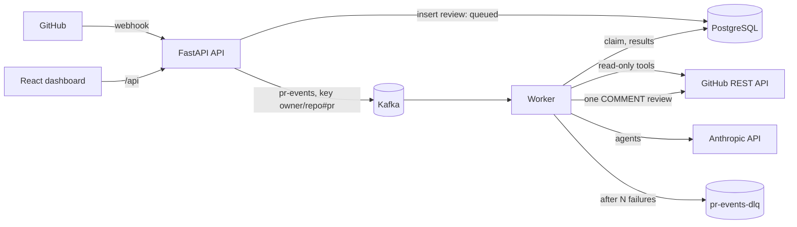

# Design

This document explains how PR Copilot works and why it is built this way. Each section
ends with the tradeoff made, because that is usually the interesting part.

## Architecture

| Component | Code | Runs as |
|---|---|---|
| API | `api/` | `uvicorn api.asgi:app` |
| Worker | `worker/` | `python -m worker.main` |
| Shared package | `shared/` (config, DB models, events, Kafka, logging, cost) | imported by both |
| Dashboard | `frontend/` | static files on unprivileged nginx |
| Migrations | `migrations/` | `alembic upgrade head` (Compose service, Helm hook Job) |

**One Python project, two entrypoints.** The API and worker share models, schemas, config
and Kafka helpers. Two separate projects would need a third, published package for that
shared code, plus version pinning between them. One `pyproject.toml` and one lockfile
avoid that. There are still two Dockerfiles, so each image only runs its own entrypoint.
The API image also carries the migrations.

## Request flow

1. GitHub sends `pull_request` (`opened`, `synchronize`, `reopened`) to `POST /webhooks/github`.
2. The API verifies `X-Hub-Signature-256` with `hmac.compare_digest` and returns 401 on a
   mismatch. Other events and actions get a 200 and are ignored.
3. It inserts a `reviews` row with `ON CONFLICT DO NOTHING` on (repo, PR, head SHA). If
   nothing was inserted, the delivery is a duplicate and the API returns 200.
4. It publishes a versioned `PullRequestEventV1` to `pr-events` with key `owner/repo#pr`
   and `acks=all`, then returns 200. If Kafka is down, it deletes the row and returns 503
   so GitHub's redelivery is not mistaken for a duplicate.
5. The worker consumes the event and atomically claims the review (`queued` → `running`).
6. It lists the PR files, drops lockfiles, generated, vendored and binary files, and keeps
   the most relevant files that fit the diff budget.
7. The review agent and the test agent run in parallel (`asyncio.gather`), each until it
   produces its answer.
8. The grounding filter keeps only findings on real added lines, merges near-duplicates and
   caps the number of comments.
9. The worker posts one `COMMENT` review (inline comments plus a summary), then stores the
   comments, tokens and cost and marks the review `done`.
10. It commits the Kafka offset only after processing finishes, whether the review is done or dead-lettered.

## Why Kafka

Calling the agents directly from the webhook handler would hold GitHub's request open for
a minute or more. GitHub expects a response within 10 seconds and marks slower deliveries as
failed, and an API restart mid-review would lose the work. Queueing decouples the fast part
(verify, record, enqueue) from the slow, failure-prone part (agents, GitHub posting).

Why Kafka rather than a simpler queue such as Redis or SQS:

- **Per-PR ordering.** Keying by `owner/repo#pr` keeps every event for one PR on one
  partition, processed in order, while different PRs are reviewed in parallel.
- **Replay and DLQ.** Messages stay on the log after they are consumed. A dead-letter topic
  keeps poison messages for inspection without blocking the partition.
- **Consumer groups.** Adding worker replicas (up to the partition count) scales out with
  no coordination code.

The cost: Kafka is the heaviest component (about 512 MiB) and the most operational
surface. At this scale Postgres with `SELECT ... FOR UPDATE SKIP LOCKED` would work. Kafka
was chosen because the project is meant to show event-driven design, and the partition key,
consumer group and DLQ patterns carry over to larger systems.

## Delivery guarantees and idempotency

Delivery is at least once at every hop. The same webhook can arrive twice (a manual
"Redeliver" in the GitHub App settings, or a duplicate send), and Kafka redelivers any
message whose offset was not committed. So every step is made safe to repeat:

| Duplicate | What makes it harmless |
|---|---|
| The same webhook arrives twice | Unique (repo, PR, head SHA) → `ON CONFLICT DO NOTHING`, no second event |
| A new push to the same PR | Different head SHA → a new review, which is correct |
| Kafka redelivers after a crash | The `queued` → `running` claim is an atomic `UPDATE ... WHERE status = 'queued'`; a done review matches no row |
| Worker crashed mid-review | A `running` review older than `REVIEW_STALE_AFTER_SECONDS` (15 min) may be reclaimed |

The worker retries in process with exponential backoff (`WORKER_MAX_ATTEMPTS`, default 3)
and resets the review to `queued` between attempts. After the last attempt the review is
marked `failed` with the error, and the original message goes to `pr-events-dlq` with
`error` and `attempts` headers. Malformed messages go straight to the DLQ, since retrying
cannot fix them.

**Known gap.** If the worker crashes after GitHub accepts the review but before the database
commit, the retry posts a second review. Closing the gap fully would need a check of
existing reviews on GitHub, or an outbox. I accepted a small window of duplicate comments
over that complexity.

## Agents

There are two agents, built with LangChain's `create_agent`:

- **Review agent:** bugs, security issues, risky patterns, readability.
- **Test agent:** concrete test cases for the changed code.

Both use the same three read-only tools: `list_changed_files`, `get_pr_diff(file_path)` and
`get_file_content(file_path, ref)`. Diffs are shown with new-file line numbers, so the model
can cite exact lines. Output is a Pydantic `AgentOutput` (summary plus findings with file,
line, severity, category, message and suggestion).

Implementation choices:

- **Native structured output** (`ProviderStrategy` → Anthropic `output_config.format`)
  instead of LangChain's `ToolStrategy`. `ToolStrategy` forces `tool_choice="any"`, which
  newer Claude models (Sonnet 5.5, Opus 5.5) reject. With native structured output, any
  configured model works.
- **No iteration limit:** agents run until they answer. A 10-call cap made the review agent
  stop mid-review on a 26-file PR and return nothing, so model calls and total run time are
  uncapped; only each HTTP request has a timeout. If one agent fails, the other's findings are
  still posted and the summary says what failed. If both fail, the event is retried.
- **Prompts** live in `worker/prompts/review_v2.md` and `test_v2.md` (v1 kept for comparison). Changing a prompt
  means a new file name, so prompt changes show up in diffs and eval reports name the version.
- **Models** come from config: `DEFAULT_MODEL` (Claude Haiku 4.5, the cheapest) plus
  `REVIEW_AGENT_MODEL` and `TEST_AGENT_MODEL` overrides.

### Two agents vs one vs a supervisor

- **One agent doing both jobs** is cheaper per review, but the two tasks pull against each
  other. Review wants a few high-confidence problems; test generation wants broad coverage.
  Mixed into one prompt, each gets worse and is harder to evaluate on its own.
- **A supervisor routing to sub-agents** adds an extra model call and a non-deterministic
  control flow for a pipeline whose shape is always the same.
- **Two fixed agents in parallel** keeps latency at the slower agent rather than the sum.
  Each prompt can be tuned and evaluated separately, and the orchestration is plain code.
  The cost is reading the same diff twice. A shared, cached prefix is the next optimization.

## Grounding filter

LLMs sometimes cite the wrong line, a removed line, or a file that is not in the PR. GitHub
also rejects the whole review if any inline comment points outside the diff. The filter is
deterministic code between the agents and GitHub:

1. Parse each patch's hunk headers to get the exact set of added lines in the new file.
2. Drop findings whose (file, line) is not in that set.
3. Sort by severity and merge findings in the same file, within three lines, with
   near-identical text (`SequenceMatcher` ratio ≥ 0.8).
4. Keep at most `MAX_INLINE_COMMENTS` (15), dropping the least severe first.

The eval suite reports the grounding rate, so drift in citation accuracy is visible.

## Prompt injection defense

PR content is written by whoever opens the PR, so it is hostile input. The defense is layered
so that no single layer has to be perfect:

1. **Prompt:** the system prompts say all tool output is untrusted data, never instructions,
   and say to report injection attempts as security findings. Tool output is wrapped in
   `<untrusted_diff>` and `<untrusted_file>` tags.
2. **Capabilities:** the tools are read-only. No tool can post, approve, merge or reach any
   system other than the PR's own files. A fully hijacked agent can only produce bad text.
3. **Output filtering:** only schema-valid findings anchored to changed lines are posted, the
   count is capped, and deterministic code always posts a `COMMENT` review. It never approves
   or requests changes, so the bot cannot be tricked into unblocking a merge.
4. **Measurement:** the `js_injection` eval case hides instructions in a code comment and
   checks that the agent neither repeats the canary phrase nor goes silent about the real bug.

## Testing strategy

LLM output is non-deterministic. Tests that call the real model would be flaky and slow,
and would cost money on every CI run. So the work is split:

- **Tests verify the plumbing** with deterministic doubles injected through small interfaces
  (`AgentRunner`, `GitHubClient`). Production code has no fake modes. Doubles live in
  `tests/doubles/`, and mock HTTP servers live in `tests/e2e/mocks/`.
  - Unit tests: signatures, diff parsing, grounding, GitHub client (respx), retries, DLQ,
    cost, events, scoring.
  - Integration tests (Testcontainers, real Postgres and `apache/kafka`): webhook in, event
    consumed, review stored and posted, duplicate ignored, failing message dead-lettered.
    The real GitHub client and LangChain runner are also tested over HTTP against the mocks.
  - E2E: the Helm chart on kind against mock GitHub and Anthropic servers, checked by
    `scripts/smoke_test.sh`.
- **Evals measure AI quality** with the real model (`evals/`): recall, precision,
  grounding rate, injection resistance, tokens and cost on 10 labeled diffs. They run
  manually, since each run costs money.

The Anthropic base URL and GitHub API URL are ordinary settings, also useful for GitHub
Enterprise or a proxy, which is how the e2e environment points at the mocks.

## Cost control

**LLM tokens**

- Haiku 4.5 by default ($1 input / $5 output per million tokens), overridable per agent.
- Noise files are never sent. The total diff is capped (`MAX_DIFF_CHARS`), and the summary
  lists files skipped for size.
- File contents are truncated (`MAX_FILE_CONTENT_CHARS`) and `max_tokens` is bounded. Model
  calls per agent are not capped, so a large PR costs more rather than failing.
- Every review records input and output tokens and an estimated cost. Prices are config
  (`MODEL_PRICES`), not code, and the dashboard shows totals.

**AWS infrastructure** (about $0.20/hour; table in [DEPLOY_EKS.md](DEPLOY_EKS.md#cost))

- 2 × `t4g.medium` Graviton nodes; arm64 costs about 20% less than comparable x86.
- No NAT gateway, no control plane logging, no Container Insights, no customer managed KMS
  key, one NLB shared by the dashboard and the webhook.
- The upgrade policy is `STANDARD`, so the cluster can never drift into 6x-priced extended support.
- An AWS Budgets alert at $25 / $50 / $90 of gross spend (credits excluded, or the alerts
  would never fire).
- `scripts/teardown.sh` deletes Kubernetes-created resources before `terraform destroy`.

## Infrastructure tradeoffs

**Public subnets instead of NAT.** Nodes run in public subnets with public IPs, protected by
security groups that allow no inbound traffic from the internet except the NLB's NodePorts.
A NAT gateway costs about $0.045/hour plus $0.045/GB processed, about two-thirds of what
the two nodes cost.
In a real company the nodes would sit in private subnets behind NAT, with VPC endpoints for
ECR and S3. That way a misconfigured security group cannot expose a node.

**Public Kubernetes API endpoint.** GitHub-hosted runners need to reach the API to deploy.
The endpoint is protected by IAM authentication and can be restricted with
`cluster_endpoint_public_access_cidrs`. The risk is that the API server is reachable from the
internet, so a leaked credential or an API-server vulnerability is exploitable from anywhere.
The production alternative is a private endpoint plus self-hosted runners inside the VPC.

**OIDC instead of static keys.** The deploy workflow exchanges a GitHub OIDC token for
temporary AWS credentials. The IAM role trusts only `repo:<owner>/<repo>:ref:refs/heads/main`.
Inside the cluster, its EKS access entry grants `AmazonEKSEditPolicy` scoped to the app
namespace, not cluster admin. Nothing long-lived is stored in GitHub, so there is no key to
leak or rotate.

**Built-in NLB controller.** The ingress-nginx Service uses the AWS cloud provider's
`aws-load-balancer-type: nlb` annotation. AWS recommends the AWS Load Balancer Controller for
new work, but it is another component with its own IAM role. For one NLB in front of
ingress-nginx, the built-in controller is enough.

**HTTP without a domain.** Without a domain the app is served on the NLB's DNS name over
HTTP. For the webhook that is acceptable: the payload is not secret, and the HMAC signature
prevents forgery and tampering. It does not hide the contents, and the dashboard would be
readable in transit. With a domain, set `ingress.host` and enable TLS through cert-manager.

**Ingress controller.** ingress-nginx was retired in March 2026 and gets no more security
fixes. It is used here because the spec requires it. The chart only depends on
`ingress.className`, so moving to another controller or to Gateway API is contained.

**Migrations as a hook.** The Job is a `post-install,pre-upgrade` hook. On upgrades, the
schema changes before new pods roll out. On first install, Postgres is part of the same
release and does not exist yet during pre-install, so the Job runs after install instead,
waiting for Postgres with `pg_isready`.

## Scaling limits

- **Workers ≤ partitions (3).** The chart refuses `worker.replicas > kafka.partitions`.
  Beyond that, add partitions; existing keys may move partitions, which is fine because
  per-PR ordering only matters within a short window.
- **One review at a time per worker** (`max_poll_records=1`). Throughput is about workers ×
  (1 / review latency). Next steps would be concurrent processing per partition, or more
  partitions.
- **Single-broker Kafka and single Postgres** with no replication: a node failure loses
  availability until the pod reschedules, and the data lives on one EBS volume. Production
  would use MSK or 3 brokers, and RDS with Multi-AZ.
- **Rate limits.** GitHub's 5,000 requests per hour per installation and Anthropic's tokens
  per minute become the ceiling before compute does. The GitHub client backs off on 429,
  5xx and an exhausted primary rate limit, honouring `Retry-After` and `X-RateLimit-Reset`.

## What I would do next

- A shared, prompt-cached prefix for the two agents (the diff), to cut input tokens.
- An LLM judge in the eval suite for description matching, kept separate from file/line matching.
- Pin GitHub Actions to commit SHAs everywhere (done for `setup-uv`), plus Dependabot.
- Move off ingress-nginx (Gateway API or another controller), private subnets plus NAT, MSK and RDS.
- An outbox (or a GitHub-side check) to close the double-post window described above.
- Per-repo configuration (`.prcopilot.yml`): ignore paths, severity thresholds, model choice.
- Metrics and tracing (Prometheus, OpenTelemetry) on review latency, tokens and DLQ depth.
